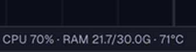

# Server Stats for Orca

[한국어](README.md)

**Server Stats** is an Orca plugin (id `server-stats`) that puts one item in the status bar at the bottom of the Orca window: the CPU, RAM, temperature and GPU use of a machine. The machine is either the computer the Orca desktop app runs on, or the one hosting a workspace on a paired Orca server.

This document describes plugin version `0.2.0` (`orca-plugin.json`).

## Screenshots




The screenshots were taken while measuring a workspace's machine. The server name that comes first on the item is cut off. The item itself starts `my-server · CPU 12% · …`, as in the examples above.

## What it shows

One item, with a gauge icon. The numbers below are examples.

For this computer, read every 2 seconds by default:

```
CPU 12% · RAM 3.4/16.0G · 54°C · GPU 8%
```

For a workspace's machine, read every 5 seconds by default. The item then starts with the name of the server the workspace is on, or of the workspace when no server is set:

```
my-server · CPU 12% · RAM 3.4/16.0G · 54°C
```

| Part | Shown as | Meaning |
| --- | --- | --- |
| CPU | `CPU 12%` | CPU use since the reading before, rounded to a whole percent |
| RAM | `RAM 3.4/16.0G` | Memory in use and memory in total, in GiB with one decimal |
| Temperature | `54°C` | The hottest sensor that can be read |
| GPU | `GPU 8%` | GPU use. For this computer, the busiest of the GPUs `nvidia-smi` reports; for a workspace's machine, the first it reports |

A metric the machine cannot report is left out, and when nothing can be read the item says `No host stats`. The text is kept within 64 characters, the most Orca accepts.

Hover for the numbers behind the label, on one line. For this computer:

```
CPU 12.4% (8 threads) · Example CPU · RAM 3.4/16.0 GiB (21%) · Core 54°, Sensor 1 49° · GPU amdgpu 8% · load 0.42 0.55 0.61 · up 2d 3h
```

For a workspace's machine, the tooltip starts by saying which workspace, and which server it is on:

```
site on my-server · CPU 12.4% (8 threads) · Example CPU · RAM 3.4/16.0 GiB (21%) · acpitz 54° · load 0.42 0.55 0.61 · up 2d 3h
```

| Tooltip part | Content |
| --- | --- |
| CPU | Use with one decimal, thread count, CPU model |
| RAM | Used / total, as `3.4/16.0 GiB` (MiB or KiB for a smaller total), and the percentage |
| Sensors | Up to 5, hottest first, as `Core 54°`; `+N more` when there are others |
| GPU | Name and use, and VRAM used / total where known |
| `load` | 1, 5 and 15 minute load averages. Left out when all are 0 |
| `up` | Time since boot, as `2d 3h`, `3h 4m` or `5m` |
| `unavailable` | What could not be read, and why. At most 3 |

Orca draws a tooltip as one line that does not wrap, so it is kept to about 180 characters where it can be, and never passes 256. A reading with a lot to say gives up detail in this order: the CPU model, then `load` and `up`, then the sensors (5 → 3 → 1 → the hottest temperature only), then GPU memory. Detail is dropped at once, since it has to be, but comes back only after the same level has fit for 8 readings in a row, so that the tooltip does not keep changing.

The item takes its warning colour, and then its danger colour, from these values up:

| Colour | CPU | RAM | Hottest sensor |
| --- | --- | --- | --- |
| `warning` | 75% | 80% | 75 °C |
| `danger` | 90% | 90% | 85 °C |

## Requirements

- **Orca 1.4.248 or newer.** This is `engines.orca` in `orca-plugin.json`; older versions refuse to load the plugin.
- **The Orca desktop app.** The status bar, and the call that updates it, exist in the desktop app only.
- **Plugins turned on.** When they are off, turn them on in Settings → Plugins or with `orca plugin system on`.
- **For a workspace's machine:** the `orca` command must be reachable from the app (see [Settings](#settings)), and the machine hosting the workspace needs `sh`. In practice that means Linux.

## Install

Run this on the computer that runs the Orca desktop app:

```sh
orca plugin install pinion05/orca-server-stats   # from GitHub
orca plugin install /path/to/orca-server-stats   # or from a folder on that computer
```

The plugin runs code, so it is not installed in one go. Without approval the command writes nothing and stops with `approval_required` (exit code 3). It prints what it would be granted, why, the publisher and the repository, and the exact command to run again, ending in `--approve <fingerprint>`. Compare that list with [What approval grants](#what-approval-grants), then run the command as printed.

- The fingerprint is bound to the plugin, its version, its files and its access. When any of them differs, a new approval is needed.
- From GitHub with no version given, Orca installs the newest version tag (`vX.Y.Z`), else the default branch, always pinned to one commit.
- The installed plugin's key is `<owner>.server-stats` from GitHub and `local.server-stats` from a folder. `orca plugin list` shows it.

```sh
orca plugin list                    # status: running, idle, pending, disabled, errored or invalid
orca plugin logs <plugin-key>       # what the worker logged
orca plugin disable <plugin-key>
orca plugin enable <plugin-key>     # code needs --approve again
orca plugin uninstall <plugin-key>
```

## What approval grants

Exactly what `orca-plugin.json` asks for. `orca plugin inspect <dir>` lists it before anything runs.

| Item | Value | Meaning |
| --- | --- | --- |
| Execution profile `execution` | `trusted-worker` | The plugin's worker (`src/worker.ts`) runs as a separate Node.js process on the Orca host, with your user account's access to that machine. |
| Capability | `settings:own` | Read and change the plugin's own settings. |

It asks for no other capability. With this access the worker:

- reads `/proc/stat` and `/proc/meminfo`, and `/sys/class/hwmon`, `/sys/class/thermal` and `/sys/class/drm` on Linux;
- runs `nvidia-smi`, and on macOS `sysctl` and `vm_stat`;
- for a workspace's machine, runs the Orca CLI: `worktree show`, and `terminal list`, `create`, `read` and `close`. It opens and closes only terminals titled `orca-server-stats`, and only in the workspace named in the settings.

The worker makes no network request of its own. Reaching a paired server is the Orca CLI's doing.

Approval is asked again when the plugin, its version, its files or its access differ from what was approved, and when a disabled plugin is enabled again.

## Settings

Orca shows them in Settings, under the plugin. A changed setting applies from the next reading on.

| Title | Key | Type | Default | Meaning |
| --- | --- | --- | --- | --- |
| Measure | `source` | `This computer` or `A workspace's machine` | This computer | Which machine is measured |
| Orca server | `environment` | text | empty | For a workspace's machine: the paired Orca server the workspace is on, by name or id. `orca environment list --json` lists the saved ones. Empty for this computer's own Orca |
| Workspace | `targetWorkspace` | text | empty | The workspace whose machine is measured, as a selector |
| Orca CLI | `orcaCli` | text | `orca` | The `orca` command run to reach that workspace. `~` stands for your home folder |
| Refresh every | `refreshSeconds` | integer, 1 to 60 | 2 | Seconds between readings |

- A value outside 1 to 60 is brought to the nearest end, and one that is not a number falls back to 2.
- This computer is read at the interval you set. A workspace's machine is read at what you set from 3 to 60; 1 and 2 give 5 seconds, since each reading starts an Orca CLI process.
- A new server, workspace, CLI command or interval closes the terminal in use, where there is one, and opens another.

## How it works

### This computer

The default, and the local mode. The Orca desktop app that has the plugin enabled starts the plugin's worker on the computer it runs on, and the worker reads that computer. One reading is a few small file reads:

- **CPU**: use between two readings of `/proc/stat` on Linux, and of the counters Node.js reports elsewhere. The first reading waits 0.4 s for a second sample.
- **RAM**: `/proc/meminfo` on Linux. On macOS, the total from `sysctl -n hw.memsize`, read once, and what is in use from `vm_stat`, at most every 5 seconds. On Windows, what Node.js reports.
- **Temperature**: Linux only. The sensors under `/sys/class/hwmon`, or the ACPI thermal zones under `/sys/class/thermal` where hwmon has none. They are read at most every 5 seconds, since they move slowly, and looked for again every 60 seconds.
- **GPU**: `nvidia-smi` where there is one, at most every 30 seconds. On Linux, a card that reports `gpu_busy_percent` under `/sys/class/drm` (`amdgpu`, `i915`, `xe` and others) stands in where `nvidia-smi` reports nothing.
- **`load` and `up`**: what Node.js reports.

### A workspace's machine

The remote mode: the machine hosting a workspace, on this computer's own Orca or on a paired Orca server. In a "remote server plus laptop app" setup it shows the server's numbers, not the laptop's.

The plugin host API has no call that chooses a server, so the worker runs the Orca CLI as a child process, as a person would from a terminal, with `ORCA_ENVIRONMENT` naming the server. The CLI takes a server or a pairing code, never both, so the plugin sets that variable itself and clears the pairing ones.

**To set it up:**

1. Set **Measure** to *A workspace's machine*.
2. **Orca server**: the paired server the workspace is on. List the saved ones with `orca environment list --json` and enter a server's name or id. Leave it empty for a workspace on this computer's own Orca.
3. **Workspace**: the selector of the workspace to measure. List workspaces with:

   ```sh
   orca worktree ps --since 30d --json    # add --environment <server> for a paired one
   ```

   Then enter `id:` followed by a row's `worktreeId`, or `identity:` followed by its `identity.key`:

   ```
   id:11111111-1111-1111-1111-111111111111::/home/me/projects/site
   identity:wt2:local:example-key
   ```

4. **Orca CLI**: when the tooltip says `unavailable: Orca CLI not found (see the Orca CLI setting)`, the app could not find the `orca` command. Set it to the command's full path, as in `~/.config/orca/cli/bin/orca`.

Without a workspace, the item says `No host stats` and the tooltip `unavailable: set the workspace to measure (targetWorkspace)`.

**What runs, and where:**

- **On the machine running the app**, each reading starts the Orca CLI as a child process, for one `orca terminal read --json`. That is why the default interval is 5 seconds and the shortest 3.
- **On the measured machine**, one terminal in that workspace, titled `orca-server-stats`, runs a small `sh` script. It prints one line of JSON per sample and nothing else:

  ```
  orca-server-stats {"v":1,"seq":54,"cpu":124,"cores":8,"mem":[16777216,3565158],"temp":[{"t":"acpitz","c":54000}],"load":"0.42 0.55 0.61","up":183603.50,"model":"Example CPU"}
  ```

  It samples every second, or less often for a long reading interval: a third of it at most, and never more than 5 seconds apart. So a reading is at most a few seconds old. The script reads `/proc/stat`, `/proc/meminfo`, `/sys/class/thermal/thermal_zone*`, `/proc/loadavg`, `/proc/uptime` and `/proc/cpuinfo`, and calls nothing but `sleep` and, where there is one, `nvidia-smi`. `nvidia-smi` is asked at most every 30 seconds, and killed if it hangs for 5 seconds.

- The worker reads the terminal's last lines, takes the newest whole line of the plugin's own, and checks every field before showing it. Whatever else the terminal holds is not read.
- The terminal stays open for as long as the plugin is enabled. It is closed when the plugin is disabled, and when the server, workspace, CLI command or interval changes.

**The name on the item.** The item names the machine at once: the server on the bar when one is set, else the workspace. The tooltip has both, the workspace first. The workspace is named as Orca shows it, or by its folder until Orca has answered.

**When the terminal is lost.** When it is closed or exits, or prints nothing new for 15 seconds (or three reading intervals, if that is longer), it is opened again: after a second, then after a wait that doubles each time up to a minute. The last good reading stays on the item for two minutes, with the reason in the tooltip, for example `unavailable: the stats terminal is gone`. Before opening a terminal, the plugin closes any terminal titled `orca-server-stats` in that workspace, so a worker that died without closing its own leaves at most one behind.

## Supported hosts

This computer:

| | Linux | macOS | Windows |
| --- | --- | --- | --- |
| CPU | `/proc/stat` | Node.js counters | Node.js counters |
| RAM | `/proc/meminfo` | `sysctl -n hw.memsize`, `vm_stat` | Node.js counters |
| Temperature | `hwmon` sensors, else ACPI thermal zones | not shown | not shown |
| GPU | `nvidia-smi`; else `amdgpu`, `i915`, `xe` through sysfs | not shown | `nvidia-smi` |
| `load`, `up` (tooltip) | both | both | `up` only |

A workspace's machine:

| Host | What the script can report |
| --- | --- |
| Linux | CPU, RAM, temperature, `load`, `up` and the CPU model, through `/proc` and `/sys`; the GPU through `nvidia-smi` |
| macOS | none of them: the tooltip says `not reported` for each |
| Windows | no reading: the script needs `sh` |

What has been tried:

- **A workspace's machine**: seen working in the Orca desktop app on macOS, showing a Linux server's CPU, RAM and temperature in the status bar.
- **This computer**: run by the tests on Linux; the macOS and Windows readings are covered by tests with fake system files only.
- **Not tried**: Windows in either mode, and macOS as a workspace's machine. The RAM reading of this computer on macOS is tested against sample output only, and has not been compared with a real Mac.

## Known limitations

**A workspace's machine**

- **Refresh every 3 seconds at the least.** 1 and 2 give 5 seconds, since each reading starts an Orca CLI process on the machine running the app.
- **A terminal titled `orca-server-stats` stays open in the measured workspace** for as long as the plugin is enabled.
- **It depends on the Orca CLI.** The `orca` command has to be reachable from the app, and the server has to be one that the Orca CLI on that computer has saved (`orca environment list`).
- **Only Linux is useful as the measured machine.** On a machine that is not Linux, what the script cannot read is left out: on macOS all of it, so the item says `No host stats`; on Windows the script does not run at all.
- **Temperature comes from the ACPI thermal zones only** (`/sys/class/thermal`), not from `hwmon`. A machine whose sensors are only under `hwmon` shows no temperature.
- **The GPU is the first one `nvidia-smi` reports**, not the busiest, unlike this computer's mode.
- **A server or workspace name longer than 14 characters is cut on the bar.** The tooltip has it whole.

**This computer**

- **On macOS, RAM is an approximation that has not been measured for real.** It is the anonymous, wired and compressor pages of `vm_stat` taken together, which stands in for Activity Monitor's "Memory Used" without being the same figure. The reading is tested against sample output only.
- **No temperature on macOS or Windows, and no GPU on macOS.**
- **Sensors that only root can read are left out**, and the tooltip says `unavailable: temperature (no readable sensor)`.

**Both**

- **The item exists in the desktop app only.**
- **Windows has not been tried in either mode.**

## When a reading fails

- A sensor that cannot be read, a missing command or a refused file never stops the worker and never shows a wrong number. The metric is left out and the tooltip says why, for example `unavailable: temperature (no readable sensor)`.
- A machine with no GPU says nothing about a GPU: having no `nvidia-smi` at all is not a failure.
- The worker logs the same failure once. After three failed updates in a row it waits 10 seconds between readings until one gets through.
- If the item still shows `…` or does not appear, check `orca plugin list`: `pending` means approval is needed. With the status `errored`, `orca plugin logs <plugin-key>` says why.

## Develop

```sh
orca plugin validate .        # the manifest, offline
orca plugin types .           # writes .orca/types, which tsconfig.json extends
orca plugin test .            # the tests in src/; runs the plugin's code on this machine
orca plugin dev watch .       # loads the folder into Orca and reloads it on change; asks for approval
npx -p typescript tsc -p .    # the type check
```

Orca transpiles the TypeScript when it loads the plugin, so there is no build step and no npm dependency. `src/types/node.d.ts` declares the little of Node the plugin calls, since Orca's typings ship without `@types/node`. `.orca/` holds the generated typings and is not committed.

```
src/
  worker.ts         the Orca worker: the poll, the settings, statusBar.update
  collector.ts      one reading of this machine: asks the reader for each metric
  system.ts         the reads: /proc, /sys, nvidia-smi, and what Node and macOS report elsewhere
  metrics.ts        the arithmetic and the status bar strings
  remote.ts         a workspace's machine: the terminal kept open, read, lost and opened again
  orca-cli.ts       the Orca CLI as a child process
  stats-command.ts  the script that runs in the terminal
  stats-line.ts     what the script prints, read back
  log.ts
  types/node.d.ts
```

The tests need no Orca: the CLI, the terminal and `nvidia-smi` are the tests' own, except that `stats-command.test.ts` runs the script for real on the machine for a moment.

## License

MIT. See [LICENSE](LICENSE).
