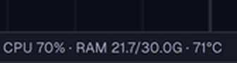
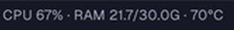

# Orca용 Server Stats

[English](README.en.md)

**Server Stats**는 Orca 플러그인(id `server-stats`)이다. Orca 창 하단의 스테이터스바에 항목 하나를 넣어 머신의 CPU·RAM·온도·GPU 사용량을 보여 준다. 머신은 Orca 데스크톱 앱이 돌고 있는 컴퓨터이거나, 페어링된 Orca 서버에서 워크스페이스를 호스팅하는 머신이다.

이 문서는 플러그인 버전 `0.2.1`(`orca-plugin.json`)을 기준으로 한다.

## 스크린샷





스크린샷은 워크스페이스의 머신을 측정할 때 찍은 것이다. 항목 맨 앞에 오는 서버 이름은 잘라 낸 상태다. 실제 항목은 위 예시처럼 `my-server · CPU 12% · …`로 시작한다.

## 보여 주는 것

게이지 아이콘이 붙은 항목 하나다. 아래 숫자는 예시다.

이 컴퓨터는 기본 2초마다 읽는다:

```
CPU 12% · RAM 3.4/16.0G · 54°C · GPU 8%
```

워크스페이스의 머신은 기본 5초마다 읽는다. 이때 항목은 그 워크스페이스가 있는 서버의 이름으로 시작하고, 서버가 설정되지 않았으면 워크스페이스의 이름으로 시작한다:

```
my-server · CPU 12% · RAM 3.4/16.0G · 54°C
```

| 부분 | 표시 | 내용 |
| --- | --- | --- |
| CPU | `CPU 12%` | 직전 측정부터의 CPU 사용률. 정수 퍼센트로 반올림 |
| RAM | `RAM 3.4/16.0G` | 사용 중인 메모리와 전체 메모리. GiB 단위, 소수점 첫째 자리까지 |
| 온도 | `54°C` | 읽을 수 있는 센서 가운데 가장 뜨거운 값 |
| GPU | `GPU 8%` | GPU 사용률. 이 컴퓨터에서는 `nvidia-smi`가 보고하는 GPU 중 가장 바쁜 것, 워크스페이스의 머신에서는 그중 첫 번째 |

머신이 보고하지 못하는 지표는 빠지고, 읽을 수 있는 것이 하나도 없으면 항목에 `No host stats`라고 보인다. 텍스트는 Orca가 받는 최대 길이인 64자 안으로 유지한다.

마우스를 올리면 숫자 뒤의 내용이 한 줄로 나온다. 이 컴퓨터의 경우:

```
CPU 12.4% (8 threads) · Example CPU · RAM 3.4/16.0 GiB (21%) · Core 54°, Sensor 1 49° · GPU amdgpu 8% · load 0.42 0.55 0.61 · up 2d 3h
```

워크스페이스의 머신에서는 툴팁이 어느 워크스페이스이고 어느 서버에 있는지부터 말한다:

```
site on my-server · CPU 12.4% (8 threads) · Example CPU · RAM 3.4/16.0 GiB (21%) · acpitz 54° · load 0.42 0.55 0.61 · up 2d 3h
```

| 툴팁 부분 | 내용 |
| --- | --- |
| CPU | 사용률(소수점 첫째 자리), 스레드 수, CPU 모델 |
| RAM | 사용 / 전체. `3.4/16.0 GiB` 꼴(전체가 작으면 MiB 또는 KiB)이고 뒤에 사용률 |
| 센서 | 최대 5개. 뜨거운 순서대로 `Core 54°` 꼴. 더 있으면 `+N more` |
| GPU | 이름과 사용률, 알 수 있으면 VRAM 사용 / 전체 |
| `load` | 1·5·15분 load average. 전부 0이면 생략한다 |
| `up` | 부팅 후 경과 시간. `2d 3h`, `3h 4m`, `5m` 꼴 |
| `unavailable` | 읽지 못한 것과 그 까닭. 최대 3개 |
| `config file` | [설정 파일](#설정-파일)이 설정 일부를 정하고 있는 동안에만. 이때 항상 줄의 맨 끝에 붙는다 |

Orca는 툴팁을 줄바꿈 없는 한 줄로 그리므로, 될 수 있는 대로 약 180자 안으로 유지하고 어느 경우도 256자를 넘지 않는다. 말이 많은 측정값은 이 순서로 덜어 낸다. 먼저 CPU 모델, 그다음 `load`와 `up`, 그다음 센서(5개 → 3개 → 1개 → 최고 온도만), 마지막으로 GPU 메모리다. 덜어 내는 것은 바로 이루어진다. 어차피 그래야 하기 때문이다. 다만 다시 늘어나는 것은 같은 수준이 8회 연속으로 들어간 뒤에야 해서, 툴팁이 계속 바뀌지는 않는다.

항목의 색은 아래 값 이상에서 경고색으로, 그다음 위험색으로 바뀐다:

| 색 | CPU | RAM | 가장 뜨거운 센서 |
| --- | --- | --- | --- |
| `warning` | 75% | 80% | 75 °C |
| `danger` | 90% | 90% | 85 °C |

## 요구 사항

- **Orca 1.4.248 이상.** `orca-plugin.json`의 `engines.orca` 값이다. 더 오래된 버전은 이 플러그인을 불러오지 않는다.
- **Orca 데스크톱 앱.** 스테이터스바와 그것을 갱신하는 호출은 데스크톱 앱에만 있다.
- **플러그인 기능이 켜져 있어야 한다.** 꺼져 있으면 Settings → Plugins에서 켜거나 `orca plugin system on`으로 켠다.
- **워크스페이스의 머신을 측정할 때:** 앱에서 `orca` 명령에 닿을 수 있어야 하고([설정](#설정)), 워크스페이스를 호스팅하는 머신에 `sh`가 있어야 한다. 사실상 Linux여야 한다는 뜻이다.

## 설치

Orca 데스크톱 앱이 돌고 있는 컴퓨터에서 실행한다:

```sh
orca plugin install pinion05/orca-server-stats   # GitHub에서
orca plugin install /path/to/orca-server-stats   # 또는 그 컴퓨터의 폴더에서
```

이 플러그인은 코드를 실행하므로 한 번에 설치되지 않는다. 승인 없이 실행하면 아무것도 쓰지 않고 `approval_required`(종료 코드 3)로 멈춘다. 그때 부여하려는 권한, 그 이유, 출판자와 저장소, 그리고 다시 실행할 정확한 명령(`--approve <fingerprint>`로 끝난다)을 출력한다. 그 목록을 [처음 로드할 때 승인되는 권한](#처음-로드할-때-승인되는-권한)과 비교한 다음, 그 명령을 그대로 실행한다.

- 지문(fingerprint)은 플러그인과 그 버전·파일·권한에 묶여 있다. 하나라도 다르면 새로 승인해야 한다.
- GitHub에서 버전을 적지 않으면 Orca는 최신 버전 태그(`vX.Y.Z`)를, 태그가 없으면 기본 브랜치를 설치하며, 어느 경우든 커밋 하나로 고정한다.
- 설치된 플러그인의 키는 GitHub에서 설치하면 `<owner>.server-stats`, 폴더에서 설치하면 `local.server-stats`다. `orca plugin list`에 보인다.

```sh
orca plugin list                    # 상태: running, idle, pending, disabled, errored 또는 invalid
orca plugin logs <plugin-key>       # 워커가 남긴 로그
orca plugin disable <plugin-key>
orca plugin enable <plugin-key>     # 코드는 --approve가 다시 필요하다
orca plugin uninstall <plugin-key>
```

## 처음 로드할 때 승인되는 권한

`orca-plugin.json`이 요구하는 그대로다. `orca plugin inspect <dir>`가 무엇이든 실행하기 전에 이 목록을 보여 준다.

| 항목 | 값 | 뜻 |
| --- | --- | --- |
| 실행 프로필 `execution` | `trusted-worker` | 플러그인의 워커(`src/worker.ts`)가 Orca 호스트에서 별도의 Node.js 프로세스로 실행된다. 그 머신에 대해서는 사용자 계정의 접근 권한을 가진다. |
| capability | `settings:own` | 플러그인 자신의 설정을 읽고 바꾼다. |

이 외의 capability는 요청하지 않는다. 이 접근 권한으로 워커는 다음을 한다:

- Linux에서 `/proc/stat`과 `/proc/meminfo`, 그리고 `/sys/class/hwmon`, `/sys/class/thermal`, `/sys/class/drm`을 읽는다.
- `nvidia-smi`를 실행하고, macOS에서는 `sysctl`과 `vm_stat`을 실행한다.
- 워크스페이스의 머신에서는 Orca CLI를 실행한다: `worktree show`, 그리고 `terminal list`·`create`·`read`·`close`. `orca-server-stats`라는 제목의 터미널만 열고 닫으며, 설정에 적은 워크스페이스에서만 한다.
- 환경 변수 또는 홈 폴더가 가리키는 자리에 있는 플러그인의 [설정 파일](#설정-파일)을 읽는다.

워커가 스스로 네트워크 요청을 하는 일은 없다. 페어링된 서버에 닿는 것은 Orca CLI가 한다.

승인된 것과 플러그인이나 그 버전·파일·권한이 달라지면, 그리고 꺼 둔 플러그인을 다시 켜면 승인을 다시 묻는다.

## 설정

Orca의 Settings에서 플러그인 항목 아래에 보인다. 바꾼 설정은 다음 측정부터 적용된다. [설정 파일](#설정-파일)로도 정할 수 있고, 파일의 값이 먼저다.

| 제목 | 키 | 형식 | 기본값 | 뜻 |
| --- | --- | --- | --- | --- |
| Measure | `source` | `This computer` 또는 `A workspace's machine` | This computer | 어느 머신을 측정할지 |
| Orca server | `environment` | 텍스트 | 비어 있음 | 워크스페이스의 머신에서: 그 워크스페이스가 있는 페어링된 Orca 서버. 이름 또는 id로 적는다. 저장된 서버는 `orca environment list --json`에 보인다. 이 컴퓨터 자신의 Orca면 비워 둔다 |
| Workspace | `targetWorkspace` | 텍스트 | 비어 있음 | 머신을 측정할 워크스페이스. selector 꼴 |
| Orca CLI | `orcaCli` | 텍스트 | `orca` | 그 워크스페이스에 닿기 위해 실행하는 `orca` 명령. `~`는 홈 폴더다 |
| Refresh every | `refreshSeconds` | 정수, 1~60 | 2 | 측정 사이의 초 |

- 1~60 밖의 값은 가장 가까운 끝 값으로 맞춰지고, 숫자가 아닌 값은 2가 된다.
- 이 컴퓨터는 설정한 간격으로 읽는다. 워크스페이스의 머신은 3~60에서 설정한 값으로 읽고, 1과 2는 5초가 된다. 측정마다 Orca CLI 프로세스가 시작되기 때문이다.
- 서버·워크스페이스·CLI 명령·간격이 바뀌면, 쓰던 터미널이 있을 때 그것을 닫고 다른 터미널을 연다.

## 설정 파일

같은 설정을 JSON 파일로도 둔다. 앱이 돌고 있는 컴퓨터의 에이전트나 스크립트가 값을 정하기 위해서다. 둘 다 Settings 화면에는 닿을 수 없다. **파일에 있는 값이 Settings의 값보다 우선한다. 키 하나하나 각각 그렇다.** 파일에 없는 키는 Settings 값을 그대로 쓰고, 파일이 없으면 모든 것이 Settings에 있는 대로다.

플러그인은 파일을 다음에서 찾는다:

- 환경 변수 `ORCA_SERVER_STATS_CONFIG`가 있고 비어 있지 않으면, 거기 적힌 경로
- 없으면 `~/.config/orca-server-stats/config.json`. `~`는 홈 폴더다

어느 쪽이든 경로는 `~`로 시작할 수 있다. 경로는 전체로 적는다. 이 변수는 플러그인의 워커를 시작하는 앱의 환경에 있어야 한다. macOS에서 Dock으로 연 앱은 셸 프로필이 정한 것을 물려받지 못하므로, 그럴 때는 파일을 홈 폴더에 둔다.

```json
{
  "source": "remote",
  "environment": "my-server",
  "targetWorkspace": "id:11111111-1111-1111-1111-111111111111::/home/me/projects/site",
  "orcaCli": "~/.config/orca/cli/bin/orca",
  "refreshSeconds": 5
}
```

- **키와 값**: 위 설정 표의 키이고, 값은 Settings 화면이 받는 것만 받는다. `source`는 `"local"` 또는 `"remote"`이다. `environment`·`targetWorkspace`·`orcaCli`는 텍스트이고 비워 둬도 되며, 길이는 각 설정이 허용하는 만큼이다. `refreshSeconds`는 1~60의 정수이고, Settings와 같이 워크스페이스의 머신에서는 1과 2가 5초가 된다. 설정이 아닌 키는 무시하고, 다섯 개 중 일부만 있어도 된다. Settings와 같이 `orcaCli`가 가리키는 명령은 사용자 계정의 접근 권한으로 실행되므로, 파일은 자신이 직접 쓰는 것이어야 한다.
- **바뀜**: 파일을 매 측정 전에 다시 읽고, 바뀐 것은 그 측정부터 적용된다. 서버·워크스페이스·CLI 명령·간격이 바뀌면, Settings에서 바뀔 때와 같이 쓰던 터미널이 있을 때 그것을 닫고 다른 터미널을 연다.
- **그만 쓰기**: 파일을 지우면 된다. 다음 측정부터 Settings 값을 다시 쓴다.
- **쓰이는 동안**: 툴팁 맨 끝에 `config file`이 붙는다. 줄의 마지막이다. 툴팁이 가장 짧아져도 자리가 없으면 빠진다.
- **쓸 수 없는 파일**은 전부 또는 일부 Settings 값에 자리를 내주고, 워커는 계속 돈다. 이유는 툴팁의 `unavailable` 항목에 있고 로그에는 한 번 남는다:
  - JSON이 아니면: 파일 전체를 쓰지 않는다. `unavailable: config file: invalid JSON`
  - JSON이지만 `[]`처럼 객체가 아니면: 파일 전체를 쓰지 않는다. `unavailable: config file: not a JSON object`
  - Settings 화면이 받지 않는 값이면: 그 값만 Settings 값을 쓰고 나머지는 파일 값을 쓴다. 틀린 키 중 첫 번째와 몇 개가 더 있는지 보인다. `unavailable: config file: invalid refreshSeconds`
  - 파일이 있는데 읽을 수 없으면: `unavailable: config file: could not be read (EACCES)`

  `orca plugin logs <plugin-key>`에는 파일 경로와 받지 않은 값이 전부 적힌다.

## 동작 방식

### 이 컴퓨터

기본값이고, 로컬 모드다. 플러그인을 켠 Orca 데스크톱 앱이 자기가 돌고 있는 컴퓨터에서 플러그인의 워커를 시작하고, 워커는 그 컴퓨터를 읽는다. 한 번의 측정은 작은 파일을 몇 번 읽는 것이 전부다:

- **CPU**: Linux에서는 `/proc/stat`를 연이어 두 번 읽어 그 사이의 사용률을 구하고, 그 밖에서는 Node.js가 보고하는 카운터로 같은 방식으로 구한다. 첫 측정은 두 번째 표본을 위해 0.4초 기다린다.
- **RAM**: Linux에서는 `/proc/meminfo`. macOS에서는 전체를 `sysctl -n hw.memsize`로 한 번 읽고, 사용 중인 양은 `vm_stat`으로 최대 5초에 한 번 읽는다. Windows에서는 Node.js가 보고하는 값이다.
- **온도**: Linux에서만 보인다. `/sys/class/hwmon` 아래의 센서, hwmon에 없으면 `/sys/class/thermal` 아래의 ACPI thermal zone. 천천히 변하므로 최대 5초에 한 번 읽고, 60초마다 다시 찾는다.
- **GPU**: `nvidia-smi`가 있으면 최대 30초에 한 번 그것으로 읽는다. Linux에서 `nvidia-smi`가 아무것도 보고하지 않으면 `/sys/class/drm` 아래에 `gpu_busy_percent`를 보고하는 카드(`amdgpu`, `i915`, `xe` 등)가 대신한다.
- **`load`와 `up`**: Node.js가 보고하는 값이다.

### 워크스페이스의 머신

원격 모드다. 워크스페이스를 호스팅하는 머신이며, 이 컴퓨터 자신의 Orca에 있거나 페어링된 Orca 서버에 있다. "원격 서버 + 노트북 앱" 구조에서는 노트북이 아니라 서버의 값이 보인다.

플러그인 호스트 API에는 서버를 고르는 호출이 없어서, 워커는 사람이 터미널에서 하듯 Orca CLI를 자식 프로세스로 실행한다. 이때 `ORCA_ENVIRONMENT`가 서버를 지정한다. CLI는 서버와 페어링 코드를 함께 받지 않으므로, 플러그인이 그 변수를 스스로 정하고 페어링 변수들을 지운다.

**설정 방법:**

1. **Measure**를 *A workspace's machine*으로 한다.
2. **Orca server**: 그 워크스페이스가 있는 페어링된 서버. `orca environment list --json`로 저장된 서버를 보고 서버의 이름 또는 id를 넣는다. 이 컴퓨터 자신의 Orca에 있는 워크스페이스면 비워 둔다.
3. **Workspace**: 측정할 워크스페이스의 selector. 워크스페이스 목록은 다음으로 본다:

   ```sh
   orca worktree ps --since 30d --json    # 페어링된 서버면 --environment <server>를 더한다
   ```

   그런 다음 행의 `worktreeId` 앞에 `id:`를 붙이거나, `identity.key` 앞에 `identity:`를 붙여 넣는다:

   ```
   id:11111111-1111-1111-1111-111111111111::/home/me/projects/site
   identity:wt2:local:example-key
   ```

4. **Orca CLI**: 툴팁에 `unavailable: Orca CLI not found (see the Orca CLI setting)`라고 보이면 앱이 `orca` 명령을 찾지 못한 것이다. `~/.config/orca/cli/bin/orca`처럼 명령의 전체 경로로 정한다.

워크스페이스를 정하지 않으면 항목에 `No host stats`가 보이고 툴팁에 `unavailable: set the workspace to measure (targetWorkspace)`가 보인다.

**무엇이 어디서 돌아가나:**

- **앱이 돌고 있는 머신**에서는 측정마다 Orca CLI 프로세스가 자식 프로세스로 시작되어 `orca terminal read --json` 한 번을 실행한다. 기본 간격이 5초이고 최소가 3초인 이유다.
- **측정되는 머신**에서는 그 워크스페이스에 `orca-server-stats`라는 제목의 터미널 하나가 열리고, 작은 `sh` 스크립트가 돈다. 스크립트는 표본마다 JSON 한 줄을 출력하고 그 외에는 아무것도 출력하지 않는다:

  ```
  orca-server-stats {"v":1,"seq":54,"cpu":124,"cores":8,"mem":[16777216,3565158],"temp":[{"t":"acpitz","c":54000}],"load":"0.42 0.55 0.61","up":183603.50,"model":"Example CPU"}
  ```

  표본은 1초마다 뜨고, 측정 간격이 길면 더 드물게 뜬다. 간격의 3분의 1을 넘지 않고, 5초보다 길게 벌어지지도 않는다. 그래서 측정값은 기껏해야 몇 초 전의 값이다. 스크립트는 `/proc/stat`, `/proc/meminfo`, `/sys/class/thermal/thermal_zone*`, `/proc/loadavg`, `/proc/uptime`, `/proc/cpuinfo`를 읽고, `sleep`과 (있으면) `nvidia-smi` 외에는 아무것도 호출하지 않는다. `nvidia-smi`는 최대 30초에 한 번 실행하고, 5초 동안 멈춰 있으면 종료한다.

- 워커는 터미널의 마지막 몇 줄을 읽어 플러그인 자신의 줄 중 가장 새로운 온전한 줄을 취하고, 보여 주기 전에 모든 필드를 검사한다. 터미널에 있는 그 밖의 내용은 읽지 않는다.
- 터미널은 플러그인이 켜져 있는 동안 계속 열려 있다. 플러그인을 끄면 닫히고, 서버·워크스페이스·CLI 명령·간격이 바뀌어도 닫힌다.

**항목에 보이는 이름.** 항목은 바로 머신의 이름으로 시작한다. 서버가 설정되어 있으면 스테이터스바에 서버 이름이, 없으면 워크스페이스 이름이 보인다. 툴팁에는 둘 다 있고 워크스페이스가 먼저다. 워크스페이스는 Orca가 보여 주는 이름으로 표시되고, Orca가 답하기 전까지는 폴더 이름으로 표시된다.

**터미널을 잃었을 때.** 터미널이 닫히거나 종료했거나, 15초 동안(측정 간격의 세 배가 더 길면 그만큼) 새 줄이 없으면 다시 연다. 처음에는 1초 뒤에, 그다음부터는 대기가 두 배씩 길어져 1분까지 기다린 뒤에 다시 연다. 마지막 정상 측정값은 2분 동안 항목에 남고 까닭이 툴팁에 보인다. 예: `unavailable: the stats terminal is gone`. 터미널을 열기 전에 플러그인은 그 워크스페이스에서 `orca-server-stats`라는 제목의 터미널을 모두 닫는다. 그래서 자기 터미널을 닫지 못하고 죽은 워커가 남기는 터미널은 기껏해야 하나다.

## 지원 호스트

이 컴퓨터:

| | Linux | macOS | Windows |
| --- | --- | --- | --- |
| CPU | `/proc/stat` | Node.js 카운터 | Node.js 카운터 |
| RAM | `/proc/meminfo` | `sysctl -n hw.memsize`, `vm_stat` | Node.js 카운터 |
| 온도 | `hwmon` 센서, 없으면 ACPI thermal zone | 표시 안 함 | 표시 안 함 |
| GPU | `nvidia-smi`, 아니면 sysfs의 `amdgpu`·`i915`·`xe` | 표시 안 함 | `nvidia-smi` |
| `load`, `up`(툴팁) | 둘 다 | 둘 다 | `up`만 |

워크스페이스의 머신:

| 호스트 | 스크립트가 보고할 수 있는 것 |
| --- | --- |
| Linux | `/proc`과 `/sys`로 CPU·RAM·온도·`load`·`up`·CPU 모델. `nvidia-smi`로 GPU |
| macOS | 하나도 없다. 툴팁에 각각 `not reported`라고 보인다 |
| Windows | 측정 없음. 스크립트에 `sh`가 필요하다 |

확인해 본 것:

- **워크스페이스의 머신**: macOS의 Orca 데스크톱 앱에서 동작을 확인했다. Linux 서버의 CPU·RAM·온도가 스테이터스바에 보였다.
- **이 컴퓨터**: Linux에서 테스트로 실행해 봤다. macOS와 Windows의 측정은 가짜 시스템 파일을 쓰는 테스트로만 확인된다.
- **확인해 보지 않은 것**: 두 모드 모두 Windows, 그리고 워크스페이스의 머신으로서의 macOS. 이 컴퓨터 모드의 macOS RAM 측정은 샘플 출력에 대한 테스트만 있고 실제 Mac과 비교하지 못했다.

## 알려진 제한

**워크스페이스의 머신**

- **갱신 최소 간격은 3초다.** 1과 2는 5초가 된다. 측정마다 앱이 돌고 있는 머신에서 Orca CLI 프로세스가 시작되기 때문이다.
- **측정되는 워크스페이스에 `orca-server-stats`라는 제목의 터미널이 하나 열려 있다.** 플러그인이 켜져 있는 동안 계속 그렇다.
- **Orca CLI에 의존한다.** 앱에서 `orca` 명령에 닿을 수 있어야 하고, 서버는 그 컴퓨터의 Orca CLI가 저장해 둔 것이어야 한다(`orca environment list`).
- **측정되는 머신으로는 Linux만 쓸모가 있다.** Linux가 아닌 머신에서는 스크립트가 읽을 수 없는 지표가 빠진다. macOS에서는 전부 빠져 항목에 `No host stats`가 보이고, Windows에서는 스크립트가 아예 돌지 않는다.
- **온도는 ACPI thermal zone(`/sys/class/thermal`)에서만 읽는다.** `hwmon`에서는 읽지 않는다. 센서가 `hwmon`에만 있는 머신은 온도가 보이지 않는다.
- **GPU는 `nvidia-smi`가 보고하는 첫 번째다.** 이 컴퓨터 모드와 달리 가장 바쁜 것이 아니다.
- **서버나 워크스페이스 이름이 14자보다 길면 스테이터스바에서 잘린다.** 툴팁에는 전체가 보인다.

**이 컴퓨터**

- **macOS에서 RAM은 근사값이고 실측해 보지 못했다.** `vm_stat`의 anonymous·wired·compressor 페이지를 합한 것으로, Activity Monitor의 "Memory Used"에 해당하는 값이지만 같은 수치는 아니다. 이 측정은 샘플 출력에 대한 테스트만 있다.
- **macOS와 Windows에서는 온도가 없고, macOS에서는 GPU도 없다.**
- **root만 읽을 수 있는 센서는 빠진다.** 툴팁에 `unavailable: temperature (no readable sensor)`라고 보인다.

**둘 다**

- **항목은 데스크톱 앱에만 있다.**
- **두 모드 모두 Windows에서 실행해 보지 않았다.**
- **설정 파일은 지켜보지 않는다.** 매 측정 전에 읽을 뿐이라, 바뀜은 늦어도 다음 측정에 보인다. 이 컴퓨터에서는 2초 안이고, 워크스페이스의 머신에서는 측정 간격 안이다(최대 60초).

## 측정이 실패할 때

- 읽을 수 없는 센서, 없는 명령, 거부된 파일 때문에 워커가 멈추거나 틀린 숫자가 보이는 일은 없다. 그 지표는 빠지고 툴팁에 까닭이 보인다. 예: `unavailable: temperature (no readable sensor)`.
- GPU가 없는 머신은 GPU에 대해 아무 말도 하지 않는다. `nvidia-smi`가 아예 없는 것은 실패가 아니다.
- 워커는 같은 실패를 한 번만 로그에 남긴다. 갱신이 연속 세 번 실패하면 하나가 성공할 때까지 측정 사이에 10초씩 기다린다.
- 쓸 수 없는 설정 파일은 실패한 측정이 아니다. Settings 값이 대신 쓰이고, 툴팁의 `unavailable`에 이유가 보이고, 로그에는 한 번 남는다. [설정 파일](#설정-파일)을 본다.
- 항목이 여전히 `…`이거나 보이지 않으면 `orca plugin list`로 상태를 본다. `pending`이면 승인이 필요하다. 상태가 `errored`면 `orca plugin logs <plugin-key>`에 까닭이 있다.

## 개발

```sh
orca plugin validate .        # 매니페스트 검사. 오프라인
orca plugin types .           # .orca/types를 만든다. tsconfig.json이 이것을 상속한다
orca plugin test .            # src/의 테스트. 이 머신에서 플러그인 코드를 실행한다
orca plugin dev watch .       # 폴더를 Orca에 올리고 바뀔 때마다 다시 불러온다. 승인을 묻는다
npx -p typescript tsc -p .    # 타입 검사
```

Orca가 플러그인을 불러올 때 TypeScript를 변환하므로 빌드 단계도 npm 의존성도 없다. `src/types/node.d.ts`는 플러그인이 쓰는 적은 양의 Node 함수를 직접 선언한 것이다. Orca의 타입 정의에 `@types/node`가 딸려 오지 않기 때문이다. `.orca/`에는 생성된 타입 정의가 있고 커밋되지 않는다.

```
src/
  worker.ts         Orca 워커: 폴링, 설정, statusBar.update
  config-file.ts    설정 파일: 어디에 있는지, 무엇을 담을 수 있는지, 쓸 수 없을 때 무엇이라고 하는지
  collector.ts      이 컴퓨터의 한 번의 측정. 지표마다 리더에게 묻는다
  system.ts         읽기: /proc, /sys, nvidia-smi, 그리고 Node와 macOS가 보고하는 것
  metrics.ts        계산과 스테이터스바 문자열
  remote.ts         워크스페이스의 머신: 열어 두는 터미널, 읽기, 잃음, 다시 열기
  orca-cli.ts       자식 프로세스로서의 Orca CLI
  stats-command.ts  터미널에서 돌아가는 스크립트
  stats-line.ts     스크립트가 출력하는 줄을 다시 읽기
  log.ts
  types/node.d.ts
```

테스트에는 Orca가 필요 없다. Orca CLI·터미널·`nvidia-smi`는 테스트가 자체적으로 대신 넣어 둔 것이고, 다만 `stats-command.test.ts`가 잠시 그 머신에서 스크립트를 실제로 돌린다. 테스트가 읽는 설정 파일은 임시 폴더에 있고 홈 폴더에는 두지 않는다.

## 라이선스

MIT 라이선스다. 내용은 [LICENSE](LICENSE)에 있다.
